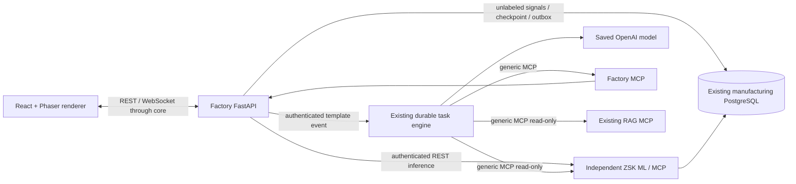

# Factory simulation engineering

This document owns the new independent domain service and its cross-service protocol. [Factory README](../factory-service/README.md) owns startup/operator procedures; core/UI/database contracts remain in their existing specifications. All domain behavior described here is implemented source behavior. Synthetic demonstrations are not industrial validation.

## Boundaries and execution

`factory-service/factory/domain.py` owns pure clock/state/action transitions; `store.py` owns SQL persistence, migrations and action ledger; `worker.py` owns two background loops; `api.py` owns authenticated REST/WS and MCP mount; `mcp_server.py` owns strict tools. Domain code stays outside core. Rendering/UI never controls time, sensors, faults, maintenance completion or authoritative state. No second LLM, agent, queue, RAG database or real-machine controller is added.

## Time, signals and recovery

`advance` integrates monotonic elapsed wall time times a persisted speed (1/5/10/60). It reconstructs timestamps from fixed `origin_timestamp + elapsed_seconds`, preventing repeated floating-point timestamp drift. Paused/downtime intervals generate no operating time. Five-minute samples have a fixed schedule; separate ingestion timestamps use PostgreSQL wall time. Clock remains active while production is stopped, so diagnostics can finish. A reset preserves absolute chronology and all history but creates a new UUID episode and paused initial state.

`Worker.clock_loop` holds a session advisory leader lock; `tick` locks the authoritative row, advances state, records action completions, samples at most 50 due measurements and saves the checkpoint in one transaction. A bounded catch-up cursor only advances for committed samples. `services_loop` uses a separate advisory lock, so inference/delivery does not block simulation ticks and a second worker cannot deliver concurrent duplicate monitoring jobs. Process/database failures release session locks. Restart loads the persisted checkpoint. No Redis or host Docker socket exists in production.

`zsk-service/zsk/synthetic.py:sensors` generates deterministic low-frequency shared load/thermal variation plus scenario effects. Torque/current/power correlate. Gearbox defects increase vibration/oil temperature and load. Flow blockage increases pressure/torque and reduces feed; thermal/feed faults oscillate. Eight scenarios define component, progression, effects and recovery. Severity is simulator truth; visual condition uses it. ML inference never receives it. Stopped drive/flow signals go to zero; repaired residual vibration/oil heat decay exponentially. These assumptions are illustrative, not manufacturer limits.

## Persistence model

Factory migration `001_factory.sql` is additive to the current ZSK database. Existing unlabeled measurements/IDs are reused; initial historical labels remain purged.

| Entity | Responsibility |
|---|---|
| `factory_state` | Singleton versioned JSON authority: clock, episode, mode, faults, technician, pending jobs, inspections, latest reading |
| `factory_measurements` | Existing measurement FK, episode, simulated timestamp/minute, ingestion timestamp, machine state |
| `factory_ground_truth` | Separate private health/scenario labels, never inference features or prediction replacements |
| `simulation_events` | Durable UUID events and monotonically increasing sequence |
| `factory_actions` | Globally unique stable request key/fingerprint, committed acknowledgment/completion and evidence |
| `machine_alarms` | Incident identity/type/component hypothesis, model evidence, lifecycle and linked core task activity |
| `factory_predictions` | Saved current-health and separate future-onset outputs per measurement |
| `monitoring_checkpoints` | Per-episode last processed ID, next simulated interval, retries/error |
| `factory_outbox` | Transactional alarm delivery, stable event ID, attempts, next retry, task ID |
| `factory_migrations` | Applied source checksum; modified applied migration fails startup |

ZSK migration `004_forecast.sql` adds versioned trusted forecast artifact metadata/metrics and unique active model. Core migration `004_task_integrations.sql` adds atomic source/event receipts linked to existing persistent tasks. RAG remains exactly its existing six domain tables.

## Current classification and future onset

The existing `zsk_model.py` RandomForest/20 causal current and rolling features remain authoritative for current classification (0=Faulty, 1=Healthy). `forecast.py` uses the same observed feature construction, but separate forward targets: onset severity ≥0.7 within the configurable horizon. Current-faulty targets and incomplete future horizons are excluded. Episode machine IDs prevent cross-episode windows. Truth/episode order is not a feature.

`fit_baseline` splits raw simulated chronology at 80%, excludes `horizon/5 + 3` raw rows before the boundary, fits only earlier labeled targets, and measures on later targets. The evaluated candidate itself is deployed; the holdout is never refit. Stable seeded scenarios enable reproducibility, but the generated distribution is limited and synthetic. Artifacts use UUID filenames, service ownership/no-symlink checks, checksum validation, fsync/atomic rename, and transactional activation. Changing horizon trains a new validated candidate before replacing the active registration. Joblib artifacts are trusted local outputs only.

`Worker.monitor` handles every unprocessed measurement through the next due interval (default ten simulated minutes), pulls two actual preceding same-machine readings, calls authenticated existing REST APIs, validates label/probability/version, and persists outputs. Future-onset inference requires a healthy current classification, running line and three continuous five-minute timestamps; otherwise a reasoned `not_applicable` warm-up/status is saved. Temporary or malformed model responses retain the cursor and retry; already persisted successful predictions are reused. A database reset cannot silently skip pending data.

## Alarms and task integration

Alarms distinguish `current_detected_fault` from `predicted_future_fault`; simulator fault injection is a separate `simulation.fault.injected` event, not an ML alarm. A component hypothesis derives from observed deviations and is explicitly uncertain. Risk values are actual registered model outputs, never example scores.

One unresolved incident per machine/episode suppresses repeated alarms and evolving component hypotheses. Resolved incidents retain a simulated-time cooldown (default 30 minutes). Acknowledgment records investigation, not recovery. Fresh running healthy current classification with below-threshold future risk and completed/cancelled investigation resolves an incident with measurement/model evidence. Reset separately resolves the old episode. Operators must not confuse this synthetic resolution rule with verified mechanical repair.

Alarm + outbox insert in the same database transaction. The worker retries authenticated `POST /api/internal/task-events`; no PostgreSQL HTTP extension and no direct LLM call exists. Core receipt/task/grants/immutable criteria commit atomically under a source/event advisory lock. Identical redelivery returns the same task ID; conflicting payloads are rejected. Core downtime keeps the pending event; response loss can safely redeliver. Worker polls authenticated receipt status to surface task progress/latest tool/report.

`core/config/task-integrations.json` is the single tracked template source. `manufacturing-alert` grants inspection and acknowledgment; `factory-stop-demo` explicitly adds simulated stop and six completion checks. Service callers cannot submit arbitrary requests/grants/commands/criteria. Events contain bounded untrusted observations, not authority. Core uses the existing `LlmService`, MCP discovery/policy and persistent `TaskWorker`; generic event-trigger UI remains removed.

Required evidence selects real scoped MCP operations: sensor records, persisted ML result, nonempty device-scoped RAG retrieval, completed inspection observation for the exact episode/component/alarm. Stop demo also verifies STOPPED and matching episode. Criteria cannot be replaced by model-generated checks. Tool success, accepted action, completed action and correct industrial diagnosis are distinct.

## Actions and authorization

Machine states: RUNNING → STOPPING → STOPPED; maintenance requires STOPPED and recorded component inspection, then MAINTENANCE → STOPPED. Stop takes five simulated seconds. Technician motion follows component coordinates, with inspection/maintenance completion waiting for arrival and simulated duration. Inspection persists a synthetic observation. Repair removes only the selected component scenarios and adds decaying residuals; restart rejects severe faults/pending work. Clock pause freezes pending jobs.

`Store.action` checks episode/machine/component/state, then commits state + stable ledger result + event atomically. Replay of the same key/fingerprint returns stored evidence; a conflicting payload fails. The SDK request context supplies authoritative harness `Idempotency-Key`/`_meta.operationId`, overriding a reused model optional key. This specifically prevents two different harness actions colliding because the LLM chose the same key. Calls without a harness key must supply a stable standalone key.

API/operator and MCP credentials are separate. The core local operator gateway is trusted for individually confirmed operator simulation actions; MCP enforces conservative automatic stop/restart/maintenance flags as well as generic core allowlist/grant approval. Epoch is required for MCP machine/technician writes. Inspection status optionally validates alarm identity/time, preventing stale completion evidence. UNKNOWN external writes still pause in the existing engine for reconciliation; no claim of exactly-once execution across arbitrary services is made.

## Synchronization and rendering

Core gateway fixes allowed upstream origin/DNS and whitelists paths, injects REST/WS credentials server-side, rejects non-local browser origins and limits payload/backpressure. It exposes `/api/factory/state`, `/measurements`, `/actions` and `/ws` to React. Browser never receives tokens.

Factory sends complete `factory.snapshot` messages with committed state version and durable event sequence. React discards older/duplicate versions, reconnects with backoff and resynchronizes full state; REST polling is a fallback. Full snapshots deliberately trade bandwidth for simple recovery; this is a local miniature environment. Phaser procedurally draws the extruder, lights, feed, screw/motor/conveyor and technician. Animations use backend mode/condition/time/character state. Component clicks open actual details; maintenance visuals follow committed pending jobs. No frame-rate-driven faults or sensors exist.

## Verification record

`docs/verification/factory/` contains actual model metrics, regression/browser/recovery results, real screenshots and live task traces. Initial failed runs are retained separately; no successful execution is inferred from a UI animation. The first live test exposed a model-provided key collision, which safely paused as UNKNOWN and motivated SDK-context key precedence. Other integration fixes included machine-wide incident deduplication, reset forecast warm-up and explicit epoch-bound completion checks.

The saved model occasionally returned incomplete/conflicting structured decisions. Strict parsing rejects them before dispatch. Decision retries increase bounded output allowance up to 32,768 tokens/context allowance; usage and lifetime/prompt caps remain enforced. Generic instructions ask for exactly one next action and a nonempty goal. Provider-dependent reliability remains a limitation; it is not hidden by deterministic test fixtures.

The model snapshot now exposes the persisted task's controlled-tool grant scope on every prompt, including after compaction, while keeping private policy digests out. This fixes conservative refusal caused by invisible authorization; no permission is expanded. Exact canonical duplication between MCP text/structured output is omitted from previews only, preserving distinct content and full saved evidence. The final report template requires numerical observations/timestamps, separate model results, source references, interpretation, verified action IDs, practical inspection recommendation and uncertainty.

`get_machine_state` returns only relevant machine/episode/mode/clock/live measurements/inspection/technician/policy/pending-job fields. Factory-wide histories remain in their separate tools/REST snapshot. The task template asks for six-record or event-scoped sensor queries. This keeps exact sensor evidence within model previews without reducing stored history or inventing summary values. The final unassisted report/action trace is recorded in `end-to-end.json` and `operator-report.md`.
