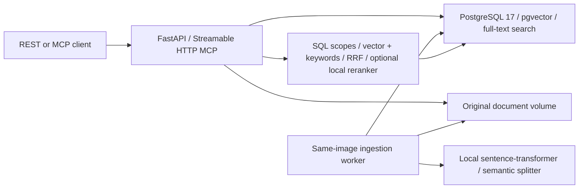

# Local RAG evidence server

Standalone Python 3.12/FastAPI retrieval service. It stores device issues and retrieves document passages over REST and MCP. It has no frontend, chatbot, answer generation, coding agent, or external AI API dependency. All embedding and optional cross-encoder inference runs locally.

## Architecture



Three containers: database, API/MCP, worker. The worker reuses the application image. No queue service is required: committed document states and JSONB ingestion metadata form a durable queue, coordinated with PostgreSQL advisory locks. The service operates independently of the parent Meta-Harness.

### Six domain tables

| Table | Purpose |
| --- | --- |
| devices | UUID, name/model/manufacturer/description, JSONB metadata, timestamps; case-insensitive unique identity |
| issues | Device FK, searchable issue fields, unconfirmed possible cause, vector, timestamps |
| documents | UUID, title/type/version/status, relative original-file path, JSONB source/ingestion metadata, timestamps |
| device_documents | Composite device/document FK; many-to-many applicability |
| document_chunks | Source FK, content/vector, section hierarchy, page/order, JSONB model/version/provenance |
| issue_evidence | Composite issue/chunk FK and explicit evidence type |

Alembic's version table is technical bookkeeping. No additional domain table exists. FK cascades prevent orphaned issues, associations, chunks, and evidence. Removing a device preserves documents; deleting a document removes its chunks/evidence and original file. Removing document applicability or moving an issue between devices removes incompatible explicit evidence links; row locks serialize these changes with new evidence links.

HNSW cosine indexes, English full-text GIN indexes, FK/filter indexes, and unique upload/ordering constraints are migrated automatically at API/worker startup under a migration lock. Embedding model name, immutable revision, dimension and normalization are stored in schema comments and chunk metadata. Both vector columns and model contracts are checked before serving. Changing model configuration on an existing database fails clearly; use an explicit migration/re-embedding process or a separate new database, never silently reuse incompatible vectors.

## Docker installation

Requires Docker Engine/Compose; first build/download needs internet for packages and model weights. Runtime requires no AI API key. CPU is the default. Allow several GB of disk for Python/PyTorch dependencies and model caches.

From this directory:

```sh
docker build -t rag-server:latest .
```

For a standalone copy, create `.env` from `.env.example` **only if no secret file exists**, generate distinct strong passwords/tokens locally, fill `RAG_DB_PASSWORD` and `RAG_API_KEY`, then `chmod 600 .env`:

```sh
python -c 'import secrets; print(secrets.token_hex(32))'
docker compose up -d --build
```

In this repository, keep secrets in the root ignored `.env` and preserve existing entries:

```sh
docker compose --env-file ../.env up -d --build
```

REST: http://127.0.0.1:8090/api. Swagger: http://127.0.0.1:8090/docs. ReDoc: `/redoc`. MCP: http://127.0.0.1:8090/mcp. Use Swagger's **Authorize** control with your bearer token. Health/schema documentation are public; all knowledge APIs and MCP requests require bearer authentication by default.

The database is private. Named volumes persist database rows, original documents and model caches. Only configured secret values are injected into relevant containers; `.env` is excluded from images and is not mounted into this stack. The application runs as UID/GID 1000, uses Docker init/signal handling, and gracefully finishes the worker's current document on shutdown. Ordinary `docker compose down` preserves named volumes; deleting volumes destroys data.

```sh
docker compose --env-file ../.env ps
docker compose --env-file ../.env logs --tail 100 rag worker
curl http://127.0.0.1:8090/health
curl http://127.0.0.1:8090/ready
```

`/health` checks process liveness; `/ready` checks connectivity, both database embedding contracts, and model initialization. Worker health checks its heartbeat and database. First model startup may take longer than health-check grace periods on slow networks; inspect sanitized logs and allow download to finish.

## Environment configuration

The complete configuration is in [rag/config.py](rag/config.py); Compose supplies the following defaults. Never put tokens in URLs, frontend variables, source files, or examples.

| Variables | Defaults / meaning |
| --- | --- |
| RAG_DB_HOST / PORT / NAME / USER / PASSWORD | Native `127.0.0.1` / `5432` / `rag` / `rag` / required secret; Compose uses `RAG_DB_HOST_DOCKER=database` (native RAG_DB_HOST does not override container DNS) |
| RAG_STORAGE_DIR / MODEL_CACHE_DIR | Native `./storage` / `./model-cache`; Compose `/data/documents` / `/data/models` |
| RAG_EMBEDDING_MODEL / REVISION / DIMENSION | `sentence-transformers/all-MiniLM-L6-v2`, pinned SHA in `.env.example`, 384 |
| RAG_EMBEDDING_DEVICE / BATCH_SIZE / TORCH_THREADS | `cpu` / 16 / 2 |
| RAG_MODEL_OFFLINE | false; set true after both model caches are populated |
| RAG_SEMANTIC_MIN_CHARS / BUFFER_SIZE / BREAKPOINT_PERCENTILE | 700 / 1 / 90; semantic split only within sufficiently long unprotected sections |
| RAG_MAX_CHUNK_TOKENS | 220, additionally capped to model token capacity |
| RAG_MAX_UPLOAD_MB / MAX_EXTRACT_CHARS / MAX_PDF_PAGES / MAX_CHUNKS | 25 / 5,000,000 / 1000 / 20,000 |
| RAG_RETRIEVAL_TOP_K / CANDIDATE_COUNT / RRF_K | 10 / 50 / 60; request top_k range 1–50 |
| RAG_SIMILARITY_THRESHOLD / ISSUE_SIMILARITY_THRESHOLD | 0.2 / 0.3 cosine similarity; not confidence probabilities |
| RAG_RERANKER_ENABLED / MODEL / REVISION | false / `cross-encoder/ms-marco-MiniLM-L-6-v2` / pinned SHA in example |
| RAG_AUTH_REQUIRED / API_KEY | true / required secret of at least 32 characters |
| RAG_PORT / LOGGING_LEVEL | 8090 / INFO |
| RAG_WORKER_POLL_SECONDS / MAX_ATTEMPTS / RETRY_SECONDS | 2 / 3 / 10; bounded exponential retry |
| RAG_MCP_ALLOWED_HOSTS | localhost, 127.0.0.1, rag, rag-api with any port; comma-separated Host allowlist |

The default image uses CPU PyTorch 2.8.0. GPU inference also needs a compatible PyTorch build (Docker `TORCH_INDEX` build argument), host NVIDIA container runtime, Compose GPU allocation and `RAG_EMBEDDING_DEVICE=cuda`; changing the environment alone does not provide a GPU. GPU deployment has not been validated here.

Model weights are cached locally at a pinned immutable commit. Set `RAG_MODEL_OFFLINE=true` only after warming **every enabled model**; missing weights fail startup. Models must not execute remote custom code (`trust_remote_code=false`). Embedding dimensions are limited to 2000 for the chosen HNSW index. Query length is bounded by the model tokenizer; overly long queries return 422 instead of silently truncating.

## REST API

All IDs are UUID strings, including device IDs; numeric IDs in the task examples were illustrative. PUT device/issue requires the full input shape; PUT document updates only supplied fields. Errors have `error.code`, a sanitized message and `request_id`; validation errors omit submitted values. Responses carry `X-Request-ID`.

| Routes | Behavior |
| --- | --- |
| GET/POST `/api/devices`; GET/PUT/DELETE `/api/devices/{id}` | CRUD; offset/limit (max 100), name substring, model/manufacturer filters |
| GET/POST `/api/issues`; GET/PUT/DELETE `/api/issues/{id}` | CRUD; device/category/symptoms filters; automatic embeddings and regeneration on searchable-field updates |
| GET `/api/documents`; POST `/api/documents/upload` | List/filter/paginate and multipart upload; upload returns 202 with ID/status immediately |
| GET/PUT/DELETE `/api/documents/{id}` | Document metadata, device associations and safe deletion |
| GET `/api/documents/{id}/status`; GET `/api/documents/{id}/chunks` | Ingestion status/errors/retry metadata and paginated source chunks |
| POST `/api/documents/{id}/reprocess` | Queue safe replacement; 409 if processing is currently locked |
| GET/POST `/api/issues/{id}/evidence`; DELETE `/api/issues/{id}/evidence/{chunk_id}` | Explicit evidence links, types and applicability validation |
| POST `/api/retrieval/search` | Structured evidence, matched issues and retrieval scores; no answer generation |

Search filters: `device_id`, optional exact `device_name`/`device_model`, `issue_category`, `document_type`, `document_ids`, `top_k`. Device matching is deterministic SQL plus name-boundary matching. Ambiguous names return 409 with candidate IDs; specify a device UUID. Queries without a matched/specified device search broadly. Evidence types: `possible_cause`, `diagnostic_procedure`, `resolution`, `supporting_observation`.

### curl examples

Requires curl and jq. Load your trusted secret file locally without printing it (`. ./.env` for a standalone copy):

```sh
set -a
. ../.env
set +a
BASE=http://127.0.0.1:8090

# 1. Create a device; duplicate identity returns 409.
DEVICE_ID=$(curl --fail-with-body -s "$BASE/api/devices" -H "Authorization: Bearer $RAG_API_KEY" -H 'Content-Type: application/json' \
  -d '{"name":"Device A","model":"X100","manufacturer":"Siemens","description":"Industrial electrical device"}' | jq -r .id)

# 2. Create an issue; documents are not required.
ISSUE_ID=$(curl --fail-with-body -s "$BASE/api/issues" -H "Authorization: Bearer $RAG_API_KEY" -H 'Content-Type: application/json' \
  -d "{\"device_id\":\"$DEVICE_ID\",\"title\":\"Clicking during startup\",\"category\":\"Sound\",\"symptoms\":\"Repetitive clicking when powered on\",\"possible_cause\":\"Defective relay\"}" | jq -r .id)

# 3. Upload a document; processing is asynchronous.
DOCUMENT_ID=$(curl --fail-with-body -s "$BASE/api/documents/upload" -H "Authorization: Bearer $RAG_API_KEY" \
  -F 'file=@samples/device-a-maintenance.md' -F 'title=Device A Maintenance Manual' -F 'document_type=manual' -F 'version=1' \
  -F "device_ids=[\"$DEVICE_ID\"]" -F 'metadata={"language":"en"}' | jq -r .id)
curl --fail-with-body "$BASE/api/documents/$DOCUMENT_ID/status" -H "Authorization: Bearer $RAG_API_KEY"

# 4. Associate a document with devices; this replaces its complete device list.
curl --fail-with-body -X PUT "$BASE/api/documents/$DOCUMENT_ID" -H "Authorization: Bearer $RAG_API_KEY" -H 'Content-Type: application/json' \
  -d "{\"device_ids\":[\"$DEVICE_ID\"]}"

# 5. Search after status becomes ready.
curl --fail-with-body "$BASE/api/retrieval/search" -H "Authorization: Bearer $RAG_API_KEY" -H 'Content-Type: application/json' \
  -d "{\"query\":\"Clicking noise during startup\",\"device_id\":\"$DEVICE_ID\",\"top_k\":5}"

# 6. Explicitly link a ready chunk, then retrieve issue evidence.
CHUNK_ID=$(curl --fail-with-body -s "$BASE/api/documents/$DOCUMENT_ID/chunks" -H "Authorization: Bearer $RAG_API_KEY" | jq -r '.items[0].chunk_id')
curl --fail-with-body "$BASE/api/issues/$ISSUE_ID/evidence" -H "Authorization: Bearer $RAG_API_KEY" -H 'Content-Type: application/json' \
  -d "{\"chunk_id\":\"$CHUNK_ID\",\"evidence_type\":\"possible_cause\"}"
curl --fail-with-body "$BASE/api/issues/$ISSUE_ID/evidence" -H "Authorization: Bearer $RAG_API_KEY"
```

For a shared manual, pass both device UUIDs in `device_ids`; example manuals and issue/device inputs live in [samples/](samples/). Fixtures are illustrative, not repair advice or confirmed diagnoses.

## Document ingestion

PDF/TXT/Markdown uploads validate extension, MIME, size, UTF-8/plain-text or PDF signature, required metadata, and existing device references. Stored names are generated UUIDs; supplied paths are never used. SHA256 + title/type/version identifies duplicate uploads, which reuse the document and merge device associations. User metadata cannot modify reserved `_source`/`_ingestion` keys.

Pipeline: persist original → queue `uploaded` → worker claims `processing` → extract PDF pages or text → detect Markdown/uppercase/colon headings and section paths → protect short safety/procedure/symptom/cause blocks → LlamaIndex `SemanticSplitterNodeParser` within sufficiently large remaining sections → token-bound passages/embeddings → atomic chunk replacement + `ready`.

Large procedures must fit embedding limits; forced fragments preserve original text and repeat nearby warnings, recording copied-warning page provenance. Heading detection is heuristic, not a generative model. PDF page numbers are preserved; TXT/Markdown pages are null. Scanned PDFs require OCR elsewhere and fail clearly if extraction yields no text. Encrypted/corrupt/empty documents fail with sanitized status details.

Transient failures retry with persisted attempt/backoff state. Worker crashes release advisory locks; interrupted work is recovered on restart. Reprocessing replaces old chunks transactionally without duplicates; **explicit issue links to replaced chunk IDs are removed and must be reviewed/recreated**. Old chunks remain stored on failed replacement, but only ready documents are searched. Change `version` through document PUT to queue reprocessing of the same original; upload updated bytes as a new version/document. PUT does not replace original bytes.

Filesystem/database commits use compensating cleanup and a periodic orphan/quarantine sweep. A crashed worker on its last allowed attempt marks the document failed only after acquiring its lock; manual reprocess resets attempts. Back up both database and document volumes together for consistent recovery.

## Retrieval

1. Resolve/filter the device deterministically; apply relational applicability and document filters.
2. Rank known issues with local cosine similarity and PostgreSQL keyword search when available.
3. Retrieve explicitly linked evidence and supporting document candidates.
4. Independently search ready document passages using vector and full-text search, even if no issue exists.
5. Merge candidate ranks using RRF, deduplicate chunk UUIDs, and optionally rerank with a local cross-encoder.

Results include device applicability, matched issue IDs, document ID/title/version, chunk ID/content, section hierarchy, page/provenance, component scores and retrieval methods. Possible causes always remain unconfirmed. RRF/cosine/cross-encoder scores are ranks/similarities, **not calibrated confidence**. Semantic matches never create explicit issue-evidence relationships.

## MCP

The pinned Python MCP SDK 1.x provides stateless Streamable HTTP at `/mcp` and structured JSON tools:

- `find_device(name, model=None)`
- `get_device_issues(device_id, category=None)`
- `search_knowledge(query, device_id=None, issue_category=None, top_k=10)`
- `get_document_context(chunk_ids)`

All reuse the REST application services. Tools are annotated read-only and return source references; they do not manage files, diagnose, or generate answers. `get_device_issues` returns up to 100 rows plus total/pagination metadata; use REST pagination for larger catalogs. Context retrieval accepts at most 100 ready chunk UUIDs and reports missing IDs.

An external client should configure Streamable HTTP URL `http://127.0.0.1:8090/mcp` with header `Authorization: Bearer <value of RAG_API_KEY>`, resolved from its local secret configuration. MCP transport also applies a Host allowlist against DNS rebinding; add your configured local hostname to `RAG_MCP_ALLOWED_HOSTS` when needed. No shell/stdio wrapper or external harness is required.

### Connect through the existing Meta-Harness UI

From the repository root (the bridge is optional for standalone use):

```sh
docker network create meta-harness-mcp # once; skip if it already exists
docker compose -f docker-compose.yml -f docker-compose.mcp.yml up -d --build
cd rag-server
docker compose --env-file ../.env -f docker-compose.yml -f docker-compose.meta-harness.yml up -d --build
```

Open http://localhost:8080 → **MCP** → **Add a server**:

1. Name: `Local RAG`.
2. Streamable HTTP URL: `http://rag-api:8090/mcp` (Docker core must use the container alias, not its own localhost).
3. Credential environment variable: `RAG_API_KEY`; its value stays in the root `.env`.
4. Choose **Add server**, then **Discover tools**.
5. Select the four read-only tools and choose **Save allowlist**.

For native core outside Docker, use `http://127.0.0.1:8090/mcp`. Registration/discovery/allowlisting persist in the existing core database. This step does not automatically invoke RAG from chat or implement a workflow/analyzer.

## Tests and maintenance

Reproducible isolated Docker test target:

```sh
docker compose --env-file ../.env -f docker-compose.test.yml up --build --abort-on-container-exit --exit-code-from tests
```

This uses a separate `rag_test` database on tmpfs and its own model cache. Tests refuse database names without `_test`/`_tests` suffixes, because migrations and cleanup are destructive. Never point tests at a knowledge database. The 30-test suite exercises CRUD, upload/applicability, PDF/TXT/Markdown extraction, protected/semantic chunking, real local embeddings and cross-encoder, vector/FTS/RRF filtering, direct search without issues, shared documents, explicit evidence, retries/reprocessing, model contracts, migrations, MCP HTTP/auth and sanitized logs.

Native Python 3.12+ development: install CPU torch from the Dockerfile's index, install `requirements.lock` and `requirements-test.lock` in a venv; load the trusted `.env`; run `python -m rag.cli api` / `worker` / `migrate`. Use an isolated PostgreSQL+pgvector test database, then `pytest -q`. Runtime and test dependency resolutions are pinned separately; requirements `.in` files record direct dependencies. Use `ruff check rag migrations tests` for static checks.

JSON logs contain request IDs, durations, sanitized failure types, filters, strategy names, and retrieved IDs, excluding raw queries, document text, API keys and database passwords. PostgreSQL error logging is configured to omit parameter/statement details. There is no generative dependency in the image.

### Troubleshooting / limits

- 401: supply the configured bearer token; changing injected secrets requires container recreation. Preserve initialized database passwords when recreating containers.
- Model mismatch: restore original model/revision/dimension; do not overwrite contract metadata to bypass re-embedding.
- Missing offline model: warm weights online in the persistent cache, then recreate with offline mode.
- Uploaded remains pending: inspect worker health/logs and database connectivity. Failed status exposes sanitized failure/retry metadata; POST reprocess retries manually.
- 409 processing busy: retry after the current worker finishes; never forcibly replace live chunks.
- Empty PDF text: OCR is intentionally external. Inspect source quality or upload a text version.
- MCP 421/connection failure: check Host allowlist, auth header, `/mcp`, Docker bridge and port; only Streamable HTTP is supported by the app's registry.
- Keyword search uses English stemming. No OCR, language-specific stemming profiles, calibrated scores, distributed job scheduler, or automatic schema/model conversion is claimed.

## File ownership

`rag/config.py`: configuration; `models.py`/`migrations/`: six-table schema and migrations; `db.py`: transactions/contracts/locks; `services.py`: structured CRUD/evidence/context; `documents.py`: uploads/storage/queue metadata; `chunking.py`: extraction/structure/semantic splitting; `embeddings.py`: local model adapters; `worker.py`: durable ingestion/retries; `retrieval.py`: SQL hybrid/RRF/reranking; `api.py`: REST/auth/OpenAPI; `mcp_server.py`: SDK tools; `middleware.py`/`observability.py`: request bounds/logs; `cli.py`: startup/migrations/worker. Dockerfile/Compose own deployment; `tests/` owns pytest fixtures and checks; `samples/` provides illustrative input files.
